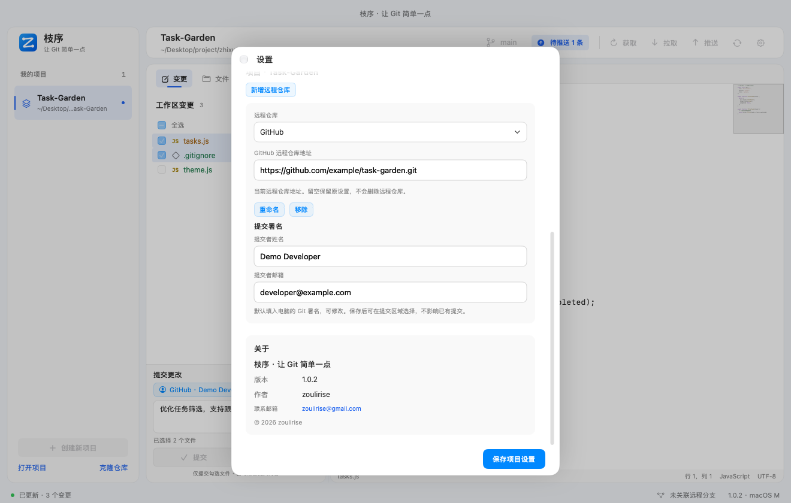

# 枝序 · 让 Git 简单一点

枝序（Zhixu）是面向日常开发的 Git 桌面工具，将项目、分支、提交、文件编辑和冲突处理集中在一个工作台。默认勾选文件直接提交，需要时再使用手动暂存。


## 下载

[下载 macOS Apple Silicon 版](https://github.com/zoulirise-bit/zhixu/releases/download/v1.0.2/Zhixu-1.0.2-macOS-arm64.dmg) · [GitHub 发行版](https://github.com/zoulirise-bit/zhixu/releases) · [Gitee 发行版](https://gitee.com/zoulirise/zhixu/releases)

要求 macOS 14 或以上、Apple 芯片（M 系列）。下载 DMG 后将枝序拖入 Applications。Windows 版正在规划，尚无安装包。对应版本 Release 发布后下载入口生效。

## 少记命令，把注意力放在代码上

### 改了很多文件，这次只想提交其中几个？

勾选需要提交的文件，直接查看差异并提交；未勾选的修改留在工作区。默认不用先理解暂存区，需要时再开启手动暂存。


### 改到一半要切换分支，担心覆盖当前修改？

检测到切换会覆盖修改时，明确选择“临时收起修改并切换”“携带修改切换”或“放弃修改并切换”。临时收起的修改之后可从备份列表选择恢复。


### 同一套代码放在 GitHub 和 Gitee，不想来回配置？

在项目设置里管理多个远程地址和署名，提交前选署名，推送或拉取时选目标。已有提交的署名保持不变，登录认证优先复用电脑现有配置。



以上均为演示项目的真实界面截图。

## 平台状态

| 平台 | 状态 | 当前要求 |
| --- | --- | --- |
| macOS | 已实现，版本 1.0.2 | macOS 14+，Apple Silicon，系统可用 Git |
| Windows | 计划中，尚无实现或安装包 | 技术方案与最低系统要求待确定 |

macOS 使用 SwiftUI/AppKit，不依赖 Node 或 Electron。Windows 计划提供相同的主要工作流程，但不会直接运行 macOS 界面代码。安装包通过 GitHub Releases 提供，源码构建方法见下文。

## 功能

- 创建、打开和克隆项目；优先使用电脑已有 Git 认证。
- 仅提交勾选文件；支持高级手动暂存模式、提交并推送。
- 分支创建、切换、重命名、删除、合并和对比。
- 切换覆盖修改时，选择临时收起、携带或放弃修改。
- 管理多个远程仓库及对应署名，在提交前选择身份；选择推送/拉取目标；显示待推送、待拉取和分叉状态。
- 临时备份列表、差异查看、指定恢复、单文件或整条备份删除。
- 提交详情、单文件历史、恢复旧版本和反向提交。
- 冲突分块处理、标记解决、继续或中止操作。
- 文件管理、忽略规则、文本编辑、语法高亮、基础补全与 Markdown 预览。
- 中文/英文、浅色/深色与跟随系统主题。

文本编辑支持 UTF-8 文件（上限 2 MB）；补全包含括号、缩进、关键词、文件内单词和基础片段，不包含语言服务器或 AI 补全。二进制文件可参与 Git 操作，不提供文本编辑。

## 从源码构建 macOS

需要 Apple Silicon Mac、Xcode 或兼容的 Swift 6 工具链，以及 Git。使用终端在仓库根目录运行：

```sh
# 获取固定版本的 GitHub CLI，并验证归档校验和
bash scripts/bootstrap-gh.sh
# 构建本地应用；不执行公证，也不生成 DMG
bash scripts/build.sh
```

输出：`dist/枝序.app`。未配置签名身份时使用本地临时签名，不需要维护者的证书。仅编译 Swift 源码可运行 `swift build --package-path apps/macos`。

详细说明：[macOS 开发](apps/macos/README.md)、[使用指南](docs/usage.md)、[贡献指南](CONTRIBUTING.md)。

## 仓库结构

```text
apps/macos/     macOS 源码、测试、平台资源和脚本
apps/windows/   Windows 规划与后续实现
assets/brand/  共用品牌图片
docs/          使用、架构和发布说明
scripts/       根目录构建和测试入口
```

两端按目录划分，采用同一主分支维护。[GitHub](https://github.com/zoulirise-bit/zhixu) 是主仓库，[Gitee](https://gitee.com/zoulirise/zhixu) 同步提供源码与发行版。平台进度和版本可以独立推进，详见 [架构与平台规划](docs/architecture.md)。

## 测试

```sh
bash scripts/test.sh
bash scripts/test-selected-commit.sh
bash scripts/test-remote-checkout.sh
bash scripts/test-completion.sh
bash scripts/test-responsiveness.sh
```

测试使用临时仓库。部分 AppKit 测试会短暂打开测试窗口；认证测试涉及临时钥匙串条目，运行前请阅读 [测试说明](docs/testing.md)。

## 许可与联系

源码采用 [MIT License](LICENSE)，作者 **zoulirise**，联系邮箱 **zoulirise@gmail.com**。第三方组件遵守各自许可证，见 [第三方说明](THIRD_PARTY_NOTICES.md)。安全问题请参考 [安全报告说明](SECURITY.md)。
